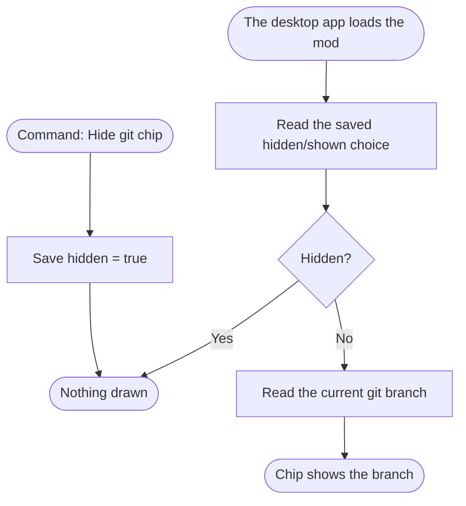

# Intake and flow chart (steps 1 to 4)

## Step 1 — the description

The user starts with a sentence or two: "a toast when my tests fail", "a status chip that shows my
git branch", "ping me on Telegram when a long job finishes". Say it back in one sentence and move to
the questions. Don't start building, and don't draw anything yet.

## Step 2 — the questions

Ask only what the description leaves open, a few at a time: `clarify` with choices where there are
choices, plain questions for anything open. Keep going until every row has a real answer.

| Ask about | Why it matters |
|---|---|
| **What it shows or does**, in the user's words | The heart of the flow chart. |
| **Where** — desktop app (pane, status-bar chip, command, page, in-app or OS notification), TUI (docked panel or modal), the CLI, a messaging platform (Discord, Telegram, Slack...), or nothing visible (it only acts) | Decides the kind (`mod-kinds.md`). Several places = several parts in one mod. |
| **When it fires** — session start or end, each turn, a tool call, a gateway event, a timer, a command | These become the events in the chart, and must be events the kind really gets (`mod-kinds.md`). |
| **What it remembers** — nothing, this session only, or across sessions | Desktop `ctx.storage`, a plugin data dir, a file; changes the tests. |
| **Commands** — a `/<name>` command? What does each argument do (hide/show, stats, settings)? | Every argument is a branch in the chart. |
| **What it must never do** — slow the reply, block a tool, send data off the machine, change files | These become rules in the README's Privacy and the code. |
| **The name** | Propose one: lowercase-with-hyphens ending in `-mod` for the package (e.g. `git-chip-mod`), and the short id without it for the plugin / widget / hook / skin and its command (e.g. `git-chip`). Let the user change it. Check `$HERMES_HOME/mods/<mod-name>/` and `mods/<mod-name>/` on the repo's `main` don't already exist, and that the short id doesn't clash with an installed extension of that kind. |

Then name the kind (desktop plugin, TUI widget, gateway hook, shell hook, Python plugin, skin) and
say in one line why it fits. If it needs two kinds (e.g. a Python plugin with a desktop pane), say
so now.

Don't add features the user didn't ask for. If one seems obviously useful (a hide/show command,
say), suggest it and let the user decide.

## Step 3 — the flow chart

Draw a Mermaid `flowchart TD` of the mod's **full behaviour**, not the build process:

- One rounded start node per event that wakes the mod ("A session starts", "Hermes finishes a
  reply", "/git-chip hide", "Every 30 seconds"), in plain words.
- A box for each thing it does (reads, works out, saves, draws, notifies, posts).
- A diamond for each decision, every outgoing link labelled (Yes/No, or the options).
- A rounded end node for each visible result ("Chip shows the branch", "Telegram: job done").
- Every command argument as its own branch.

Example shape:



Show it as a ```mermaid block, then **read it back in plain words**, numbered, branch by branch.
Before asking for a yes, check it and flag by name:

- A decision with only one labelled way out, or unlabelled links out of a decision.
- A box nothing leads to, or a step with nothing after it that isn't a visible result.
- Something the user asked for in step 2 that no box does.
- Something in the chart the user never asked for.
- A start event the chosen kind never receives (e.g. a gateway hook "when a CLI session starts").

## Step 4 — the yes

Ask: "Is this everything the mod should do?" Change what they ask and show it again; loop until an
explicit yes. Then save the approved chart, exactly, to `docs/flow.mmd` in the package folder. The
same text goes in the README's "How it works" section (`mod-folder-layout.md`).
